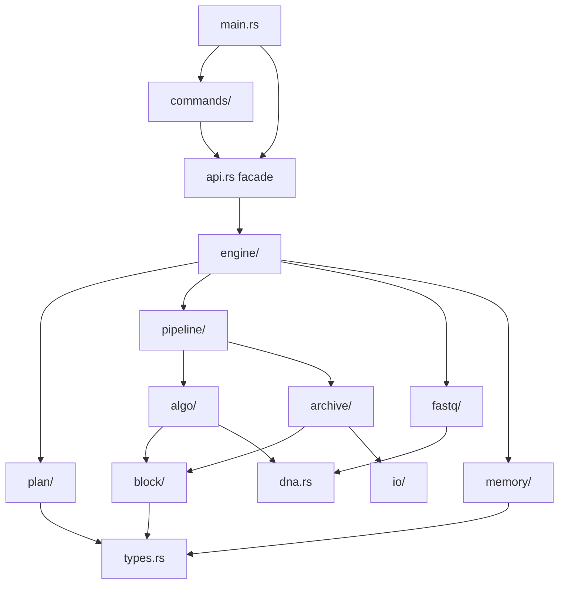
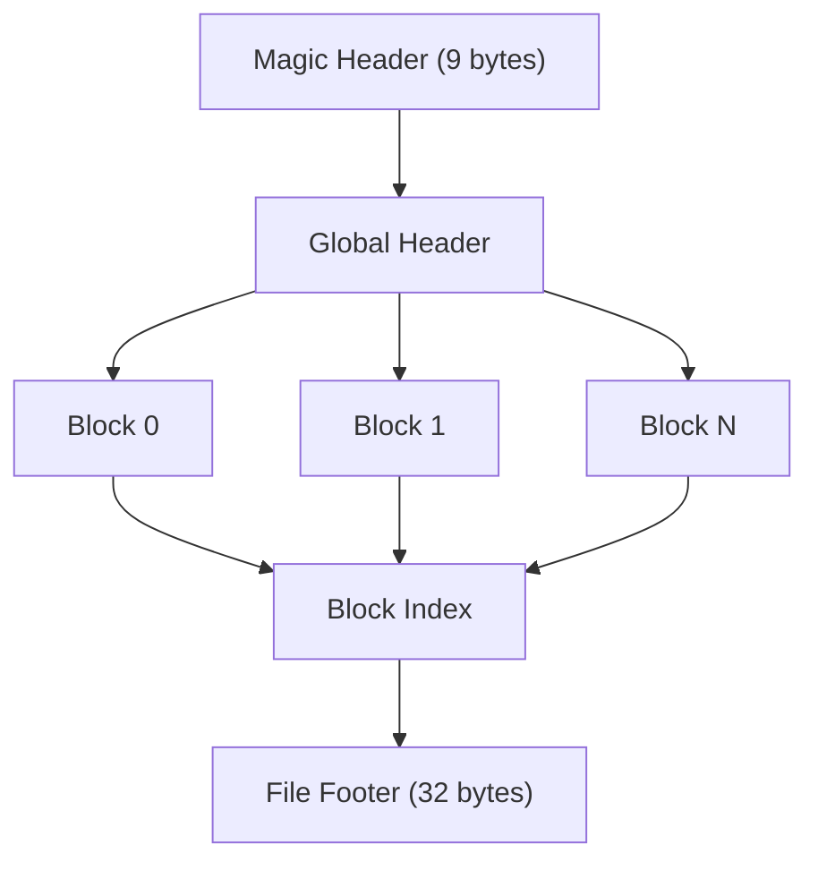

# 架构概述

`fqc` 是一个单一二进制 Rust CLI。模块按依赖方向分层，而不是仅按文件名分组：

关键约束：

- `algo` 与 `archive` 不互相依赖，只通过中立的 `block` 领域类型（`BlockMeta` / `EncodedBlock` / `DecodedBlock`）交接。
- `io`、`fastq`、`memory`、`plan` 不依赖 `archive` / `algo` / `pipeline` / `engine` / `commands`。
- `tests/test_architecture.rs` 对上述 import 方向做轻量守护，避免 Rust 模块循环在四门禁全绿时悄悄回退。

## 主要层次

| 层次 | 关键文件 | 职责 |
| --- | --- | --- |
| CLI | `src/main.rs`, `src/commands/*` | 解析参数、打印摘要、映射退出码 |
| Facade | `src/api.rs` | 稳定的 compress / decompress / info / verify 嵌入入口 |
| 计划与校验 | `src/plan/*` | 私有字段的 request、执行模式、重排策略、块/worker 固定点规划 |
| 压缩编排 | `src/engine/compression_engine.rs`, `src/engine/compression_engine/*_runner.rs` | 模式路由；archive / streaming / pipeline 各自 runner |
| 流水线 | `src/pipeline/*` | 块级并行压缩与解压；compress pipeline 仍是完整摄入 |
| 算法 | `src/algo/*` | ABC、质量模型、ID、全局分析；只依赖 `block` |
| 归档格式 | `src/archive/*` | `.fqc` 字节布局、reader/writer、原子输出事务接入 |
| 中立块域 | `src/block/*` | 编码块/解码块元数据与 ID varint 编解码 |
| 基础设施 | `src/fastq`, `src/io`, `src/memory`, `src/dna.rs`, `src/stats.rs`, `src/types.rs` | 解析、压缩流、预算、DNA 工具、统计与核心类型 |

## 归档模型

`.fqc` 归档包含：

1. 包含模式标志和归档元数据的全局头
2. 一个或多个压缩块
3. 可选的重排映射
4. 文件尾和块索引

这种布局使 `fqc info`、`fqc verify` 和范围解压可以基于归档结构操作，而非将文件视为不透明块。

## 执行模式

压缩操作通过 `CompressionEngine` 路由，选择三种执行模式之一：

- **Archive 模式**（默认）：完整摄入，可选重排和全局分析
- **Streaming 模式**（`--streaming`）：按块增量摄入，禁用重排；块阶段与 archive/pipeline 共享，但只预取固定数量的块，常驻内存与输入大小无关
- **Pipeline 模式**（`--pipeline`）：先完整摄入并做全局分析，再并行压缩块；块阶段有界，但不是低内存摄入路径

每种模式保持相同输出格式和 CLI 语义，同时变化内存占用和并发行为。

## 性能路线图

当前瓶颈、优化方向和活跃阶段边界的维护摘要见 [性能路线图](./performance-roadmap.md)。
